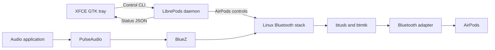

# Architecture and Bluetooth support

This project adds an XFCE tray interface to the modified LibrePods daemon in
[omarchy-pods](https://github.com/thisisgm/omarchy-pods). The tray displays
battery state and sends AirPods control commands. Audio playback and microphone
capture remain the responsibility of the Linux audio and Bluetooth stack.

## Control and audio paths

The active daemon comes from `vendor/omarchy-pods/daemon`. The separate
`vendor/librepods-upstream` submodule provides the original LibrePods source
for comparison; it is not built or launched by these scripts. Both revisions
are pinned in [`sources.lock.json`](../sources.lock.json).

One headless daemon maintains the AirPods control connection. The GTK 3 tray
watches its status file and invokes `librepods-ctl` when a setting changes.
It does not maintain a second AirPods connection. Device capability flags
determine which listening modes and other controls appear in the menu.

The daemon handles battery information, listening modes, and related AirPods
features. PulseAudio handles playback and recording through BlueZ. On the
tested PulseAudio configuration, A2DP supplies stereo playback and the
hands-free profile supplies microphone input with call-quality playback.
Switching between these profiles changes the audio endpoints.

## XFCE startup and installation

The installer places the daemon, control CLI, tray, and launcher under
`~/.local`. It creates an XFCE autostart entry and two user services. The tray
unit depends on `librepods.service` and receives the graphical environment
through the autostart launcher.

Some XFCE sessions do not activate `graphical-session.target`. The installer
therefore adapts the supplied daemon unit to `default.target`, while retaining
its service hardening. XFCE autostart imports the display environment before
starting the tray.

Installation saves original files and a restore manifest under ignored
`local/`. Repeated installation preserves the original baseline. Uninstallation
restores that baseline where the installed files have not subsequently changed.
Keep the checkout and its `local/` directory until the integration is removed.

## Optional motherboard support

The tray installation does not require a particular motherboard. The optional
hardware scripts and `airpods-tools` helper target the ASUS ROG Crosshair
X870E Hero's MediaTek MT7927/MT6639 adapter, USB `0489:e13a`. Use the tray's
ordinary Bluetooth and audio settings with other adapters.

The affected Debian kernel configurations have two initialization requirements:
the correct MT6639 Bluetooth firmware and a `btusb` device-ID entry selecting
the MediaTek setup path. Generic USB Bluetooth matching can bind an interface
without selecting that path, leaving the controller down with an all-zero
address.

The firmware preparation script extracts a hash-verified payload from an
official ASUS archive. The driver preparation script applies a four-line
device-ID patch to hash-verified Linux stable source. The existing `btmtk`
implementation supplies MT6639 support, the chip-ID workaround, firmware-section
filtering, and the firmware path; it is not replaced.

The driver installer checks the motherboard, firmware, source manifest, Secure
Boot state, and exact kernel ABI. It builds both supported ABIs before
installing either through DKMS. It then checks the resolved module path, loaded
srcversion, and actual controller initialization. Compilation alone does not
establish that a controller works.

Driver installation and removal reload Bluetooth and disconnect its devices.
DKMS archives the original modules for restoration. Automatic installation for
future kernels is disabled so older driver source cannot silently replace a
newer kernel's Bluetooth fixes. See the [driver guide](mt6639-driver.md) for
scope and rollback, and the [firmware guide](mt6639-firmware.md) for provenance.

## Validation and troubleshooting

The [validation record](validation.md) separates build results, bounded hardware
tests, and untested behavior. A healthy control connection or a running audio
sink does not prove audible sound. Confirm stereo by listening in both ears,
then test the real microphone source separately.

The [operations guide](operations.md) provides pairing, audio-profile, and
diagnostic procedures. Compare playback with the daemon stopped and running
when isolating a control-layer interaction. Transport errors can guide further
investigation, but they do not by themselves identify defective hardware or
radio interference.

Read [PRIVACY.md](../PRIVACY.md) before sharing diagnostics. Runtime settings,
pairing keys, device addresses, and raw logs are local data, not project source.
