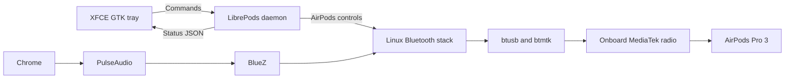

# AirPods Pro 3 on Debian 13 and XFCE

On 9 November 2026, AirPods Pro 3 playback worked in both ears through the
motherboard's onboard MediaTek Bluetooth adapter. The user confirmed clear
audio after the adapter was activated and the AirPods were paired with it.
Debian 13, XFCE 4.20, BlueZ 5.82, and PulseAudio 17.0 remained in use. A desktop
replacement, a move to Debian unstable, and an audio-server replacement were
not required for this result.

The active adapter is the MediaTek MT7927/MT6639 on the ASUS ROG Crosshair X870E
Hero motherboard, identified by USB ID `0489:e13a`. Its Bluetooth function uses
an internal USB connection; its appearance in USB tools does not mean that it
is an external dongle. At the successful test it was `hci0`. The external
Realtek adapter, USB ID `0b05:1bf6`, was `hci1` and was powered off after checking
that it had no connected devices. It can be unplugged. Controller numbering
can change after reload or reboot, so subsequent checks must use the hardware
identity rather than assume that `hci0` always means MediaTek.

This report records the successful baseline playback test and the subsequent
restoration of the daemon and tray. A separate onboard microphone test also
passed. The [validation record](validation.md) tracks these acceptance checks
and the remaining longer-duration and application-level tests.

## Architecture and desktop integration

Ordinary audio and AirPods-specific controls follow different paths. Chrome
sends playback to PulseAudio. PulseAudio uses BlueZ and the kernel Bluetooth
drivers to reach the selected radio. Stereo playback uses A2DP; the microphone
uses the separate hands-free profile. On this installation, selecting the
microphone profile changes the available playback mode.

LibrePods manages the AirPods control connection, including battery readings
and listening-mode commands. This repository uses the pinned modified daemon
from [omarchy-pods](https://github.com/thisisgm/omarchy-pods), whose interface
supports the tested Pro 3. The upstream
[LibrePods source](https://github.com/librepods-org/librepods) is also pinned
for comparison. Exact revisions are recorded in
[`sources.lock.json`](../sources.lock.json); the daemon sources were not changed.



The original Omarchy panel depends on its desktop shell. A small GTK 3 tray
application provides the corresponding interface in XFCE's notification area.
It reads the daemon's status file and sends commands when a setting changes.
One headless daemon and one tray process run as user services. The installer
changes the daemon's startup target to `default.target` because this machine
does not activate `graphical-session.target`. XFCE autostart supplies the
display environment and starts the tray service.

The build passed all 19 daemon CTest tests and all six XFCE status-reader tests.
Desktop entries and user service units passed their validators. A screenshot
of the actual tray menu confirmed readable battery rows and controls. These
checks establish software and interface behavior; they do not establish radio
reliability or audible playback.

## Investigation and the targeted correction

Initial testing used the external Realtek adapter. The control connection
reported separate battery readings and both AirPods in ear. Transparency,
Adaptive, and Noise Cancellation each produced an actual device mode readback.
The daemon does not update this mode optimistically, so these were responses
from the AirPods, not merely acknowledgments that a command had been sent.
The original Noise Cancellation setting was restored after the checks.

The external adapter also carried a successful microphone input test: ten
seconds of 16 kHz mono samples showed changing energy while the user spoke,
without clipping. No recording was retained. That result establishes the
Linux microphone path through that adapter. It does not establish microphone
operation through the newly activated onboard adapter or in a conferencing
application.

Playback through the external adapter was unreliable. It briefly produced
sound, then became muffled, played in one ear, or became silent. Chrome was
routed to the AirPods, mute and volume settings were correct, and both output
channels contained nonzero music. Selecting SBC XQ was not a successful fix.
With the daemon and tray stopped, discovery off, and standard SBC selected,
the same audible failure remained. PulseAudio debug output showed skips and
underruns, with SBC bitpool falling from 29 to 2. Bitpool controls the amount
of data used for SBC encoding; the observed reduction accompanied the failed
playback but does not identify its underlying cause.

The same AirPods worked normally on the user's phone. This and the daemon-off
test narrowed the investigation, but neither proves that the dongle is
defective or that radio interference caused the problem. The external audio
path remains undiagnosed. The practical next step was to activate the unused
onboard radio and test an independent Bluetooth path.

Two concrete gaps prevented the onboard controller from initializing. It was
down with an all-zero address. First, the required firmware file was missing,
and the inspected Debian stable and backports firmware packages did not
contain it. Second, the installed `btusb` modules lacked the board's specific
device-ID entry. Generic Bluetooth USB matching bound the interface without
selecting MediaTek initialization.

The firmware was extracted as data from the official ASUS MTK WiFi driver
archive V5.6.0.3998. The archive checksum matched the value published by ASUS.
No Windows installer or third-party installation script was executed. The
installed Bluetooth payload is:

```text
Path: /usr/lib/firmware/mediatek/mt7927/BT_RAM_CODE_MT6639_2_1_hdr.bin
SHA-256: 669c5c99a0c59c85c1285d3d1b8b31915c2d31341a2244f4eddcbfd60ffbbc76
```

The [firmware procedure](mt6639-firmware.md) records the archive hash, extraction
reference, and [official ASUS source](https://www.asus.com/uk/supportonly/rog%20crosshair%20x870e%20hero/helpdesk_download/).
Root ownership, file permissions, and the installed payload hash were verified.

The existing `btmtk` module already contained MT6639 support, the chip-ID
workaround, firmware-section filtering, and the correct firmware path. The
remaining change was a four-line `btusb` patch adding USB ID `0489:e13a` with
`BTUSB_MEDIATEK` and `BTUSB_WIDEBAND_SPEECH`. It selects existing driver logic.
It does not replace the Bluetooth stack. The source was taken from the
[upstream Linux v6.12.115 tag](https://github.com/gregkh/linux/blob/v6.12.115/drivers/bluetooth/btusb.c)
and checked against recorded SHA-256 hashes before patching.

Both exact Debian kernel ABIs were built and installed through DKMS:

| Kernel ABI | Patched module srcversion |
| --- | --- |
| `6.12.115+deb13.1-amd64` | `29AC947EAFB09F046C1A14A` |
| `6.12.116+deb13-amd64` | `29AC947EAFB09F046C1A14A` |

Independent reviews through Claude CLI and Astra identified packaging issues
that were corrected before installation. Source preparation now hashes an
explicit seven-file set, avoiding a reproduced failure in which the manifest
hashed its own previous contents. Both modules build before either is
installed. The installer verifies copied sources, restricts kernel scope,
checks the resolved module path and loaded srcversion, and attempts rollback
on build, installation, or load failure.

The user ran the privileged installer. Live checks then confirmed that the
running kernel resolved `btusb` to `/lib/modules/<kernel>/updates/dkms/btusb.ko.xz`
and had loaded the tested srcversion. The onboard controller initialized,
obtained a nonzero address, and became powered and `UP RUNNING`. Receive and
transmit error counters were zero at inspection. These runtime checks supplied
the evidence that compilation alone could not provide.

## Pairing and the successful playback test

The external adapter was powered off to isolate the onboard path. The first
pairing attempt returned `AuthenticationRejected` while the AirPods were not
in pairing mode. After the user confirmed the case's white flashing light and
a `NoInputNoOutput` default agent was registered, pairing succeeded. BlueZ
reported the device paired and trusted, with services resolved.

Chrome was routed to the onboard adapter's A2DP sink using standard SBC at
40 percent output volume. During a 40-second baseline capture, the stream
remained `RUNNING`, controller error counters stayed at zero, and the
PulseAudio debug capture contained no matching bitpool, skipping, underrun,
error, or failure lines. The user then confirmed that audio worked in both
ears. This combines routing evidence, a bounded diagnostic capture, and
direct listening evidence. It is not a long-duration reliability test.

The successful result supports a specific conclusion: activating and using
the onboard Bluetooth path resolved the user's reported playback failure in
this test. It does not establish the cause of the external adapter's failure.
It also explains why switching to KDE or Debian unstable was unnecessary.
The demonstrated blocker was below the desktop interface: missing firmware
and device-specific initialization on the onboard radio. XFCE already
supported the tray interface, and the existing stable audio stack delivered
the successful playback once that radio worked.

## Operation, rollback, and maintenance

The [README](../README.md) describes user-level build and installation. The
[firmware procedure](mt6639-firmware.md) and
[driver procedure](mt6639-driver.md) describe the separate privileged hardware
steps. Keep these layers distinct when maintaining the installation. Removing
the tray integration with `./scripts/uninstall` restores tracked user files
where safe and retains pairing data and Debian packages. Keep the ignored
`local/` restore manifest and backups for that operation.

The driver override can be removed with
`sudo ./scripts/remove-mt6639-driver`. This disconnects Bluetooth devices,
removes the DKMS override, and reloads the distribution driver. It retains the
verified firmware. On the two affected stock kernels, removing the override
also removes the device-ID correction required for onboard initialization.
Recovery handlers attempt to reload a driver and restart Bluetooth if an
operation fails; a failed cleanup must still be inspected rather than assumed
successful. Failed DKMS cleanup preserves its source for diagnosis.

This workaround has a deliberate maintenance boundary. `AUTOINSTALL="no"`
prevents the older source from silently overriding future kernel drivers.
Only the two recorded ABIs are supported. Before moving to another kernel,
check whether its stock driver contains this device ID and whether its
firmware support is sufficient. If a correction remains necessary, review
and build against the appropriate source before relying on that kernel.
The present procedure assumes Secure Boot is disabled and refuses an enabled
configuration; it does not configure module signing.

After the baseline passed, the daemon and tray were restored. The daemon
reported a healthy control connection, separate battery readings, and both
AirPods in ear. The GTK tray was embedded in the XFCE panel. A second,
30-second PulseAudio debug capture with controls running contained no matching
transport-degradation lines.

The microphone was then tested through the onboard adapter in the 16 kHz mono
hands-free profile. During five seconds of speech, one-second RMS levels ranged
from -33.0 to -18.7 dBFS, and the maximum sample magnitude was 14883 out of
32768. The samples were not clipped, and no recording was retained. The helper
restored A2DP/SBC stereo afterward and verified the onboard connection.

Normal reconnection after a fresh login and suspend/resume, longer playback,
and conferencing-application input remain untested. Case-battery refresh,
conversation awareness, one-AirPod noise cancellation, and physical ear-removal
behavior also need separate hardware checks.

Pairing keys, Bluetooth addresses, raw logs, local screenshots, firmware
binaries, and compiled modules are excluded from this report and repository
content. The scripts and recorded hashes make the correction reviewable
without publishing those local artifacts.
